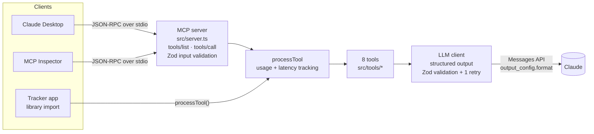

# IP Contingency MCP Server

A [Model Context Protocol](https://modelcontextprotocol.io) server that exposes 8 LLM-powered tools for IP assignment compliance analysis. It finds gaps where a patent or trademark lacks a signed assignment from the person who created it, and explains what to do about them.

It runs two ways:

- **As an MCP server** over stdio, built on the official `@modelcontextprotocol/sdk`. Claude Desktop, MCP Inspector or any MCP client can list and call the tools.
- **As a library.** `processTool()` runs a tool in-process. The [IP Contingency Tracker](https://github.com/nakulk02/ip_contingency_tracker) app uses it this way.

## Tools

| Tool | What it does | Input |
| --- | --- | --- |
| `analyzeGaps` | Patterns, root causes and risk areas across many gaps | `gaps[]` |
| `recommendActions` | Priority, next steps, timeline and jurisdiction notes for one gap | `gap` |
| `detectAnomalies` | Unusual delays, deviations, violations and risk spikes, with evidence | `gaps[]`, `context?` |
| `generateAdvisory` | Executive advisory report with prioritised action items | `gaps[]`, `companyContext?` |
| `rankPriorities` | 1-100 priority score, urgency factors and resolution time per gap | `gaps[]` |
| `queryAssignments` | Turns a natural-language question into filters and returns matching gaps | `question`, `gaps[]` |
| `checkCompliance` | Checks one gap against its jurisdiction's assignment rules | `gap` |
| `predictRisk` | Predicts the resolution outcome, with confidence and weighted factors | `gap`, `historicalContext?` |

Every tool has a Zod input schema (`src/schemas/index.ts`). The MCP server publishes these as JSON Schema in `tools/list` and validates `tools/call` arguments against them before anything reaches the LLM.

## Architecture



```
src/
├── server.ts             # MCP entry point: McpServer + StdioServerTransport
├── index.ts              # Library entry point: processTool(), getToolDescriptions()
├── mcp/
│   ├── create-server.ts  # Registers the 8 tools on an McpServer
│   └── tool-definitions.ts  # Name, title, description and input schema for each tool
├── schemas/              # Zod schemas for tool inputs and LLM outputs
├── tools/                # The 8 tool implementations
├── prompts/              # System prompt for each tool
├── utils/
│   ├── llm-client.ts     # Anthropic SDK wrapper (structured output, retries, usage logging)
│   ├── usage.ts          # Per-tool-call token and latency accounting
│   └── logger.ts         # pino logger; writes to stderr so stdout stays free for MCP
└── types/                # Shared TypeScript types
```

### Structured output

Each tool that needs JSON back from the model passes a Zod schema to `callLLMJSON()`:

1. The schema is sent as `output_config.format` through the SDK's `messages.parse()` and `zodOutputFormat()`. The API then constrains the model to JSON that matches it.
2. The parsed result is validated again with the same Zod schema.
3. If validation fails, the call is retried once with the validation error in the prompt. A second failure returns an `LLM_RESPONSE_INVALID` error instead of malformed data.

Responses cut off at `max_tokens`, and refusals, are also reported as errors. This replaces the earlier approach of pulling the first `{...}` out of free text with a regex. That approach broke on tools that return arrays (`detectAnomalies`), and `generateAdvisory` split its sections with a regex. Both now use schemas.

### Token usage and latency

Every LLM call logs `inputTokens`, `outputTokens`, `latencyMs`, `model` and `stopReason`. `processTool()` adds up all the LLM calls one tool made (some make two, and a retry adds one) and logs a per-tool line:

```json
{"level":30,"tool":"analyzeGaps","success":true,"durationMs":4210,"llmCalls":1,"inputTokens":1830,"outputTokens":412,"llmLatencyMs":4188,"msg":"Tool execution completed"}
```

The same numbers are returned as `usage` on every `ToolResponse` and in the MCP `structuredContent`.

## Setup

```bash
npm install
cp .env.example .env      # add ANTHROPIC_API_KEY
npm run build
```

| Variable | Required | Default |
| --- | --- | --- |
| `ANTHROPIC_API_KEY` | yes | |
| `ANTHROPIC_MODEL` | no | `claude-sonnet-5` |
| `LOG_LEVEL` | no | `debug` in development, `info` in production |

## Use with MCP Inspector

```bash
npm run build
npx @modelcontextprotocol/inspector node dist/server.js
```

Open the Inspector UI, click **List Tools**, choose `analyzeGaps` and paste the `gaps` array from [`examples/sample-gaps.json`](examples/sample-gaps.json).

For a quick check from the terminal, `npm run smoke` starts the built server over stdio and lists its tools. If `ANTHROPIC_API_KEY` is set, it also calls `analyzeGaps` on the sample data.

## Use with Claude Desktop

Add the server to `claude_desktop_config.json`:

- macOS: `~/Library/Application Support/Claude/claude_desktop_config.json`
- Windows: `%APPDATA%\Claude\claude_desktop_config.json`

```json
{
  "mcpServers": {
    "ip-contingency": {
      "command": "node",
      "args": ["/absolute/path/to/ip_contingency_mcp/dist/server.js"],
      "env": {
        "ANTHROPIC_API_KEY": "sk-ant-..."
      }
    }
  }
}
```

Restart Claude Desktop. The 8 tools appear under the tools menu. Paste gap data into the chat and ask, for example, "Rank these gaps and tell me which to fix first."

The package also declares a `bin` entry, so after `npm install -g` (or `npm link`) the command is just `ip-contingency-mcp`.

## Use as a library

```typescript
import { processTool } from "ip-contingency-mcp";

const result = await processTool({ tool: "analyzeGaps", input: { gaps } });

if (result.success) {
  console.log(result.data);   // AnalysisResult
  console.log(result.usage);  // { llmCalls, inputTokens, outputTokens, llmLatencyMs, durationMs }
}
```

To embed the MCP server in another process, use `createMcpServer()` from `ip-contingency-mcp/mcp` and connect any MCP transport.

## Tests

```bash
npm test             # unit + in-process MCP integration tests (no API key needed)
npm run type-check
npm run smoke        # real stdio round trip against dist/server.js
```

- `src/mcp/__tests__/server.test.ts` starts the server in-process over an in-memory transport. It checks that `tools/list` returns all 8 tools with schemas, runs `analyzeGaps` through `tools/call` with the LLM client mocked, and checks that invalid arguments are rejected before any LLM call.
- `src/utils/__tests__/llm-client.test.ts` covers structured-output validation, the single retry, `max_tokens` handling and usage accounting.
- `src/tools/__tests__/tools.test.ts` runs individual tools against a mocked LLM.

## Notes

`dist/` is committed on purpose. The tracker installs this package as a git dependency (`github:nakulk02/ip_contingency_mcp`), and npm doesn't run build scripts for git dependencies by default. Run `npm run build` and commit `dist/` with any source change.
